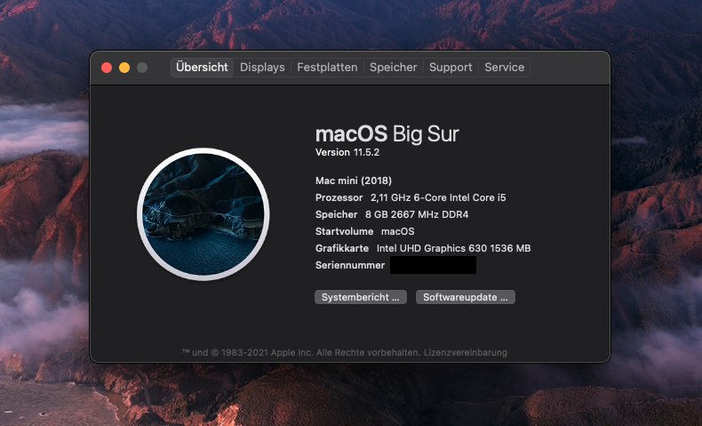
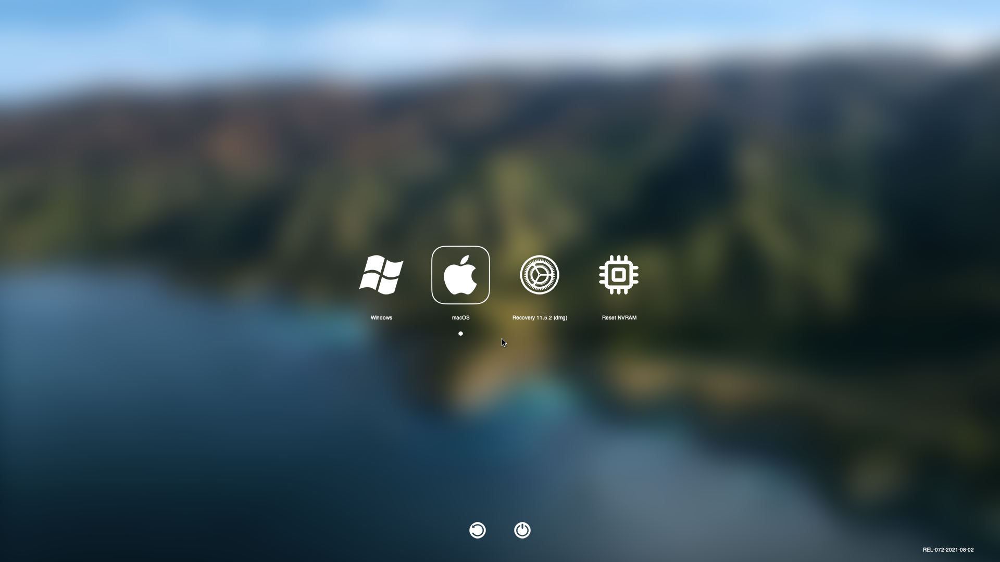

## HP EliteDesk 800 G4 Mini OpenCore EFI

This repository contains a generic [OpenCore](https://github.com/acidanthera/OpenCorePkg) based **EFI folder** for booting macOS on **HP EliteDesk 800 G4 Mini** computers.

This EFI is based off the excellent work of [deeveedee](https://www.insanelymac.com/forum/profile/1099364-deeveedee/) over at [insanelymac](https://www.insanelymac.com/forum/topic/343937-guide-catalina-big-sur-monterey-ventura-sonoma-sequoia-tahoe-on-hp-elitedesk-800-g4g5-mini-the-perfect-macmini81-hackintosh/).

For more information on how to install macOS on a **HP EliteDesk 800 G4 Mini** please consult the linked thread above.

For convenience sake this repository includes the recommended UEFI configuration and additional *DeviceProperties* configurations in the [EXTRAS folder](EXTRAS).

Currently based on **OpenCore 1.0.8**, covering macOS Mojave through Tahoe.

Features of this EFI:

* Working macOS boot
* Working BootCamp
* Graphical boot picker via OpenCanopy with [BigSurFlat theme](https://github.com/82ghost82/BigSurFlat), [GoldenGate Extended](https://github.com/HJebbour/GoldenGateExt-OpenCore-Theme) and Acidanthera's stock themes included as alternatives
* 15 port limit of BigSur is complied with by disabling the internal ports for the WiFi/BT module
* USB port map is compatible with both macOS Tahoe and earlier releases
* Boots macOS releases that no longer support *Macmini8,1* (Tahoe) via the *Skip Board ID check* booter patch
* Per-OS boot entry icons (Windows 10, Windows 11, Linux) via OpenCanopy flavours
* Working Ethernet on every supported macOS: IntelMausi on Mojave, IntelMausiEthernet from Catalina on, selected automatically
* Working audio on every supported macOS: AppleALC up to Sequoia, VoodooHDA on Tahoe, selected automatically
* Disabled boot chime

### Setup

Before using this EFI, replace the following *PlatformInfo > Generic* values in *config.plist* with your own *use [GenSMBIOS](https://github.com/corpnewt/GenSMBIOS)): `MLB`, `ROM`, `SystemSerialNumber` and `SystemUUID`.

Then apply the UEFI settings from [the UEFI configuration document](EXTRAS/HP_EliteDesk_800_G4_Mini_UEFI_Configuration.md).
Intel ME must be enabled for proper sleep/wake of the UHD 630.

### Boot picker themes

The boot picker theme is selected with *Misc > Boot > PickerVariant*. All bundled themes work with the shipped *PickerAttributes* (`145`) and need no other change:

| `PickerVariant`             | Theme                                                                                                              |
| --------------------------- | ------------------------------------------------------------------------------------------------------------------ |
| `daniele/BigSurFlat`        | [BigSurFlat](https://github.com/82ghost82/BigSurFlat) (default)                                                     |
| `Acidanthera/GoldenGateExt` | [GoldenGate Extended](https://github.com/HJebbour/GoldenGateExt-OpenCore-Theme) 3.0 - GoldenGate with icons for every macOS release, many Linux distributions and Windows 10/11 |
| `Acidanthera/GoldenGate`    | Acidanthera's stock macOS 11 style theme                                                                           |
| `Acidanthera/Syrah`         | Acidanthera's stock OS X 10.10 style theme                                                                         |
| `Acidanthera/Chardonnay`    | Acidanthera's stock Mac OS X 10.4 style theme                                                                      |

GoldenGate Extended ships without the *FirmwareSettings*, *NetworkBoot* and *OpticalDrive* icons that OpenCanopy 1.0.8 knows about, so this EFI adds them from the stock GoldenGate theme it is based on. Its README suggests *PickerAttributes* `147`; the extra bit (`OC_ATTR_USE_DISK_LABEL_FILE`) only makes the picker use pre-rendered `.disk_label` files for entry titles and is optional.

### Audio on macOS Tahoe

Apple removed `AppleHDA` in macOS Tahoe, so **AppleALC.kext** no longer produces audio there. This EFI ships **VoodooHDA_BL.kext** alongside it as a replacement, and **no configuration is needed** - the two are scoped by macOS version and never both drive the codec:

| Kext                  | `MinKernel` | `MaxKernel` | Active on             |
| --------------------- | ----------- | ----------- | --------------------- |
| **AppleALC.kext**     | `12.0.0`    | `24.99.99`  | Mojave … Sequoia      |
| **VoodooHDA_BL.kext** | `25.0.0`    | -           | Tahoe and newer       |

VoodooHDA attaches directly to the HDA PCI device, so on Sequoia and older it would compete with `AppleHDAController` - `MinKernel` `25.0.0` stops it from ever being injected there. AppleALC only patches `AppleHDA`, so on Tahoe it would do nothing; `MaxKernel` `24.99.99` keeps it from loading there at all, as recommended by the guide.

**VoodooHDA_BL.kext** is the *bootloader* build of VoodooHDA: it embeds the parts of `IOAudioFamily` it needs instead of linking against Apple's kext, which is what allows OpenCore to inject it with SIP fully enabled. The regular **VoodooHDA.kext** cannot be injected on Tahoe and only works when installed to `/Library/Extensions` - do not use both at the same time. Two consequences of the bootloader build:

* Apple drivers that depend on `IOAudioFamily`, most notably `AppleUSBAudio`, do not load on Tahoe. USB headsets and USB DACs need the `/Library/Extensions` route instead.
* The bundled kext has *VoodooHDAEnableVolumeChangeFix* set to *true* (needed for the menu bar and keyboard volume controls on this machine) and matches the controller as either `HDAS` or `HDEF`. Re-apply both changes to the *Info.plist* when replacing the kext with a newer build.

Two optional extras:

* **Volume and input gain control** - install [VoodooHDA.prefPane](https://github.com/CloverHackyColor/VoodooHDA/releases) to `/Library/PreferencePanes/`. Without it you get working audio but no fine-grained mixer control.
* **Layout matching** - VoodooHDA auto-detects the Conexant CX20632 by default, which is the tested   configuration. If you would rather have it follow the same AppleALC layout this EFI uses, add   `voodoo-layout-id` = `<14000000>` to *DeviceProperties > Add > PciRoot(0x0)/Pci(0x1F,0x3)*.

VoodooHDA is GPLv2 and is **not** an Acidanthera project - sources are at
[CloverHackyColor/VoodooHDA](https://github.com/CloverHackyColor/VoodooHDA).

#### Alternative audio solutions

If the bundled **VoodooHDA_BL.kext** does not fit your needs, these alternatives exist for Tahoe. Use only one at a time: disable **VoodooHDA_BL.kext** in *Kernel > Add* and remove any other audio kext from `/Library/Extensions` first. Test changes from an EFI on a USB stick.

| Solution | How it is loaded | SIP (`csr-active-config`) | Notes |
| -------- | ---------------- | ------------------------- | ----- |
| **VoodooHDA.kext** ([regular build](https://github.com/CloverHackyColor/VoodooHDA/releases)) | Installed to `/Library/Extensions` | `<03000000>` to install, `<01000000>` to run | Keeps Apple's `IOAudioFamily`, so USB audio devices keep working. Set *VoodooHDAEnableVolumeChangeFix* = *true* in its *Info.plist* before installing |
| **[HDAUniversal](https://www.insanelymac.com/forum/topic/362932-hdauniversal-applehda-like-audio-kext-for-macos-tahoe-and-hackintosh-systems/)** | Installer, to `/Library/Extensions` | `<03000000>` to install, `<01000000>` to run | AppleHDA-like driver with very good audio quality; sleep/wake issues were reported on this machine |
| **[SimpleHDA](https://www.insanelymac.com/forum/topic/363336-simplehda-the-most-perfect-tahoe-sound-card-scheme)** | Injected by OpenCore | `<00000000>` | Brings `AppleHDA` back on Tahoe, driven by **AppleALC.kext**. Add it to *Kernel > Add* **after** AppleALC with *MinKernel* `25.0.0`, and clear AppleALC's *MaxKernel*. Needs boot-arg `keepsyms=1` (already set). New and experimental |
| **[OpenCore Legacy Patcher](https://github.com/dortania/OpenCore-Legacy-Patcher)** root patch | Restores `AppleHDA` on the system volume | `<03080000>` | Breaks the sealed system volume and has to be re-applied after every macOS update (see below). Clear AppleALC's *MaxKernel* |

### SIP and OpenCore Legacy Patcher

This EFI ships with SIP fully enabled (*NVRAM > Add > 7C436110-… > csr-active-config* = `<00000000>`) and does **not** bundle [OpenCore Legacy Patcher](https://github.com/dortania/OpenCore-Legacy-Patcher). OCLP cannot be shipped inside an EFI folder - it is a macOS application that builds its own OpenCore EFI and root-patches the installed system volume, which breaks the APFS snapshot seal and requires AMFI and parts of SIP to be disabled.
The guide author [recommends against it](https://www.insanelymac.com/forum/topic/343937-guide-catalina-big-sur-monterey-ventura-sonoma-sequoia-tahoe-on-hp-elitedesk-800-g4g5-mini-the-perfect-macmini81-hackintosh/) on production machines for that reason, and the VoodooHDA route above avoids needing it for audio.

If you do need a different SIP level, change `csr-active-config`:

| Value        | Meaning                                                      |
| ------------ | ------------------------------------------------------------ |
| `<00000000>` | SIP fully enabled (default in this EFI)                       |
| `<01000000>` | Allow untrusted kexts - needed only to run VoodooHDA or HDAUniversal from `/Library/Extensions` (use `<03000000>` while installing them) |
| `<03080000>` | Required by OCLP root patches                                 |

Injecting VoodooHDA via OpenCore as described above keeps SIP fully enabled, so `<00000000>` is fine.

### Images

